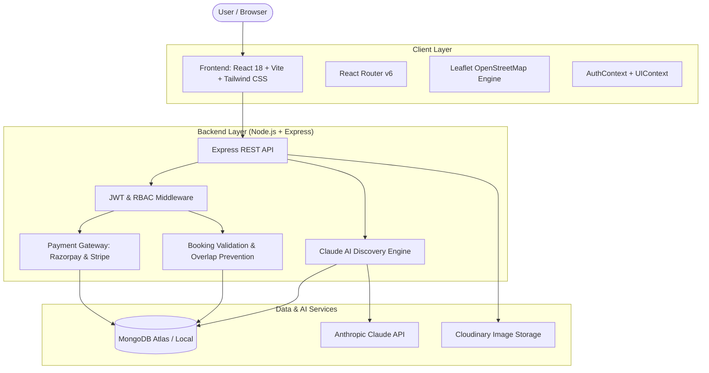

# SELFCON — Real Estate Redefined
> **One platform. Every property journey. Powered by AI.**

SelfCon (Self-Comfort) is an enterprise-grade, modern, full-stack real estate marketplace that unifies **short-term stays**, **long-term residential rentals**, **property buying**, and **property selling** in a single intuitive application. 

Its key differentiator is **SelfCon AI**—a conversational property discovery engine powered by **Anthropic Claude API** that transforms natural-language lifestyle queries into structured database queries against real MongoDB listings with tailored match explanations and alternative recommendations.

---

## 🏛️ System Architecture



---

## 📂 Complete Project Folder Structure

```
SELFCON/
├── backend/
│   ├── config/
│   │   └── db.js                        # MongoDB Atlas / In-Memory auto-fallback connection
│   ├── controllers/
│   │   ├── adminController.js           # Platform KPIs, user management, property moderation
│   │   ├── aiController.js              # Claude AI conversational endpoint & prompt parser
│   │   ├── authController.js            # JWT auth, register, login, profile, role switching
│   │   ├── bookingController.js         # Booking requests, validation, payment confirmation
│   │   ├── messageController.js         # In-app buyer/tenant & owner conversation threads
│   │   ├── notificationController.js    # In-app notifications & read receipts
│   │   ├── offerController.js           # Purchase offers, counters, visits scheduling
│   │   ├── propertyController.js        # Multi-mode property CRUD, search, calendar blocks
│   │   ├── reviewController.js          # Property ratings, reviews & host replies
│   │   └── userController.js            # User dashboard, favorites, fraud reports
│   ├── middleware/
│   │   ├── auth.js                      # JWT verification & role authorization (RBAC)
│   │   ├── error.js                     # Centralized API error handling
│   │   └── upload.js                    # Multer multipart file upload handling
│   ├── models/
│   │   ├── Booking.js                   # Stays & rentals with date conflict prevention
│   │   ├── Conversation.js              # Direct messaging thread
│   │   ├── Favorite.js                  # User wishlist collection
│   │   ├── Message.js                   # Chat messages between users
│   │   ├── Notification.js              # System and activity notifications
│   │   ├── Offer.js                     # Purchase offers, counters, inspection visits
│   │   ├── Property.js                  # Multi-mode properties with coordinates & specs
│   │   ├── Report.js                    # Trust & Safety fraud moderation reports
│   │   ├── Review.js                    # 5-star category ratings & comments
│   │   └── User.js                      # 6 Roles: Guest, Tenant, Buyer, Owner, Seller, Admin
│   ├── routes/
│   │   ├── adminRoutes.js
│   │   ├── aiRoutes.js
│   │   ├── authRoutes.js
│   │   ├── bookingRoutes.js
│   │   ├── messageRoutes.js
│   │   ├── notificationRoutes.js
│   │   ├── offerRoutes.js
│   │   ├── propertyRoutes.js
│   │   ├── reviewRoutes.js
│   │   ├── uploadRoutes.js
│   │   └── userRoutes.js
│   ├── seed/
│   │   └── seed.js                      # Automated seed for 6 roles, multi-mode listings & reviews
│   ├── services/
│   │   ├── bookingValidationService.js  # Server-side date validation & overlap prevention
│   │   ├── claudeService.js             # Claude API natural language parser & match ranking
│   │   └── paymentService.js            # Razorpay & Stripe signature verification & orders
│   ├── .env                             # Environment variables configuration
│   ├── .env.example                     # Environment template
│   ├── package.json
│   ├── server.js                        # Express server entry point
│   └── test-ai.js                       # CLI test script for Claude AI discovery
├── frontend/
│   ├── public/
│   ├── src/
│   │   ├── components/
│   │   │   ├── home/
│   │   │   │   ├── AiSearchModal.jsx    # Signature conversational AI discovery modal
│   │   │   │   ├── FeaturedProperties.jsx # Curated properties grid with mode badges
│   │   │   │   ├── HeroSection.jsx      # Hero with Stay/Rent/Buy tabs & AI quick input
│   │   │   │   ├── HowItWorks.jsx       # 3-step modern platform walkthrough
│   │   │   │   ├── PopularDestinations.jsx # City cards with counts (Mumbai, Goa, Dubai...)
│   │   │   │   └── Testimonials.jsx     # Social proof across tenants, buyers, and owners
│   │   │   └── layout/
│   │   │       ├── Footer.jsx           # Clean footer with category links & trust badges
│   │   │       └── Navbar.jsx           # Modern navigation, role switcher, currency, bell
│   │   ├── context/
│   │   │   ├── AuthContext.jsx          # JWT user state, login, register, switchRole
│   │   │   └── UIContext.jsx            # Currency switcher, comparison drawer, AI launcher
│   │   ├── pages/
│   │   │   ├── AdminDashboardPage.jsx   # Root console: metrics, users, moderation, reports
│   │   │   ├── AiDiscoveryPage.jsx      # Dedicated Claude AI full-screen discovery chat
│   │   │   ├── CreatePropertyPage.jsx   # Multi-mode property creation wizard
│   │   │   ├── HomePage.jsx             # Portfolio-grade landing page
│   │   │   ├── LoginPage.jsx            # Authentication with 1-click demo accounts
│   │   │   ├── MessagesPage.jsx         # In-app buyer/host messaging interface
│   │   │   ├── OwnerDashboardPage.jsx   # Host portal: KPIs, listings, offers, calendar blocker
│   │   │   ├── PropertiesPage.jsx       # Unified marketplace with filters & interactive map
│   │   │   ├── PropertyComparisonPage.jsx # Side-by-side comparison of up to 4 homes
│   │   │   ├── PropertyDetailPage.jsx   # Flagship listing page with booking & offer forms
│   │   │   ├── RegisterPage.jsx         # Registration with role selection
│   │   │   └── UserDashboardPage.jsx    # User portal: bookings, offers, wishlist, settings
│   │   ├── services/
│   │   │   └── api.js                   # Axios HTTP client with JWT interceptors
│   │   ├── App.jsx                      # Route configurations & protected routes
│   │   ├── index.css                    # Tailwind CSS directives & Leaflet styling
│   │   └── main.jsx                     # Vite React DOM root
│   ├── index.html                       # HTML5 template with Google Fonts & Leaflet
│   ├── package.json
│   ├── postcss.config.js
│   ├── tailwind.config.js               # Custom brand palette, animations & soft shadows
│   └── vite.config.js                   # Vite dev server with /api proxy
├── package.json                         # Monorepo convenience scripts
└── README.md
```

---

## 🗄️ Database Schemas (MongoDB Collections)

### 1. `Users`
- `name`: String
- `email`: String (Unique, Indexed)
- `password`: String (Bcrypt salted hash)
- `role`: Enum (`guest`, `tenant`, `buyer`, `owner`, `seller`, `admin`)
- `phone`: String
- `avatar`: String URL
- `bio`: String
- `verified`: Boolean
- `savedProperties`: [ObjectId -> Property]
- `recentSearches`: [{ query, mode, timestamp }]

### 2. `Properties`
- `title`, `slug`, `description`: String
- `owner`: ObjectId -> User
- `listingModes`: [Enum (`stay`, `rent`, `buy`)] — Multi-mode support allows a home to be listed for short-term stays, long rentals, or sale simultaneously.
- `propertyType`: Enum (`apartment`, `villa`, `studio`, `penthouse`, `house`, `townhouse`)
- `location`: `{ address, city, state, country, zipCode, coordinates: { lat, lng } }`
- `specs`: `{ bedrooms, bathrooms, squareFeet, maxGuests, furnishing, yearBuilt, parkingSpaces }`
- `pricing`: `{ nightly, weekly, monthly, salePrice, cleaningFee, securityDeposit, currency }`
- `amenities`: Array of strings (e.g., `'High-Speed WiFi'`, `'Swimming Pool'`, `'Gym'`, `'Dedicated Workspace'`)
- `images`: Array of `{ url, publicId, isPrimary }`
- `status`: Enum (`active`, `pending_approval`, `under_contract`, `sold`, `rented`, `inactive`)
- `availability`: `{ availableFrom, minimumStayNights, blockedDates: [{ startDate, endDate, reason }] }`
- `stats`: `{ viewsCount, favoritesCount, averageRating, reviewsCount }`

### 3. `Bookings`
- `property`: ObjectId -> Property
- `user`: ObjectId -> User (Guest / Tenant)
- `host`: ObjectId -> User (Owner)
- `bookingMode`: Enum (`stay`, `rent`)
- `checkInDate`, `checkOutDate`: Date
- `pricing`: `{ rate, unitsCount, subtotal, cleaningFee, serviceFee, securityDeposit, totalAmount, currency }`
- `status`: Enum (`pending`, `confirmed`, `cancelled`, `completed`, `refunded`)
- `payment`: `{ provider, orderId, paymentId, paymentStatus, paidAt }`
- Server-side validation guarantees zero conflicting dates.

### 4. `Offers`
- `property`: ObjectId -> Property
- `buyer`: ObjectId -> User
- `seller`: ObjectId -> User
- `offerAmount`: Number
- `financingType`: Enum (`cash`, `conventional_mortgage`, `fha`, `other`)
- `preApproved`: Boolean
- `status`: Enum (`pending`, `accepted`, `rejected`, `countered`, `withdrawn`)
- `counterOffer`: `{ amount, terms, closingDate, counteredAt }`
- `scheduledVisit`: `{ requestedDate, timeSlot, status }`

### 5. `Conversations` & `Messages`
- In-app threaded direct communication between buyers/tenants and owners/sellers.

### 6. `Reviews`
- Overall 1-5 star rating + category ratings (cleanliness, accuracy, communication, location, value) with host response capability.

### 7. `Favorites`, `Notifications`, `Reports`
- User wishlists, real-time activity alerts, and Trust & Safety fraud moderation reports.

---

## 🤖 SelfCon AI Property Discovery (Module 4)

Users can enter natural-language prompts such as:
> *"I need a quiet 2-bedroom apartment for three months with high-speed internet and a gym nearby, under $2,000 per month."*

### How the Engine Works:
1. **Entity Extraction**:
   - Understands intent (`rent` for 3 months).
   - Extracts budget (`maxPrice: 2000`).
   - Identifies bedrooms (`bedrooms: 2`) and property type (`apartment`).
   - Recognizes lifestyle nuances: `'quiet'` -> Quiet & Peaceful; `'high-speed internet'` -> High-Speed WiFi; `'gym nearby'` -> Gym / Fitness Center.
2. **Real MongoDB Search**:
   - Constructs verified MongoDB Mongoose queries against real database documents.
   - **Never hallucinates fake properties**: Real `_id` and stored fields are strictly used.
3. **Claude Match Ranking & Explanations**:
   - Analyzes real candidate properties against the user's requirements.
   - Generates a personalized match score (e.g., `94% Match`) and cites why the property matches (e.g. *"2 bedrooms match your requirement. Equipped with High-Speed WiFi, Gym / Fitness Center. Monthly rent of $1400 fits your $2000/mo limit."*).
4. **Intelligent Alternatives**:
   - If an ultra-restrictive query returns 0 exact matches, the engine relaxes criteria and suggests verified alternatives with clear explanations.

---

## 🔑 Pre-Configured Demo Accounts (All 6 Roles)

Password for all pre-seeded demo accounts: `password123`

| Role | Email | Use Case |
|---|---|---|
| **Admin** | `admin@selfcon.com` | Access Root Admin Operations, KPI analytics, user role updates, fraud moderation |
| **Property Owner** | `owner@selfcon.com` | Host of Azure Horizon Villa & Bandra Penthouse. Manage bookings, calendar dates & revenue |
| **Seller** | `seller@selfcon.com` | Owner of Dubai Waterfront Villa & Tribeca Loft. Review purchase offers and counter-offers |
| **Tenant** | `tenant@selfcon.com` | Software Engineer renting executive suites. View active lease bookings & wishlist |
| **Buyer** | `buyer@selfcon.com` | Real estate investor. Submit binding purchase offers and schedule in-person tours |
| **Guest** | `guest@selfcon.com` | Vacation explorer. Book short-term stays with instant checkout |

---

## 🚀 Installation and Local Running Guide

### Prerequisites
- Node.js v18+ (tested on Node v24)
- npm v9+

### 1. Backend Setup
```bash
cd backend
npm install
node seed/seed.js   # Seeds database with 6 roles, multi-mode listings, bookings & reviews
npm start           # Starts API server on http://localhost:5000
```

### 2. Frontend Setup
```bash
cd frontend
npm install
npm run dev         # Launches Vite React development server on http://localhost:5173
```

---

## ⚙️ Environment Variables

### `backend/.env`
```ini
PORT=5000
NODE_ENV=development

# MongoDB Connection (Auto-detects local MongoDB or spins up MongoMemoryServer gracefully)
MONGODB_URI=mongodb://127.0.0.1:27017/selfcon
USE_MEMORY_DB=false

# Authentication
JWT_SECRET=selfcon_super_secret_jwt_key_2026_redefined
JWT_EXPIRES_IN=7d

# Anthropic Claude API (Optional - deterministic verified NLP fallback enabled out-of-the-box)
ANTHROPIC_API_KEY=your_anthropic_api_key_here

# Image Storage (Optional - local fallback enabled)
CLOUDINARY_CLOUD_NAME=your_cloud_name
CLOUDINARY_API_KEY=your_api_key
CLOUDINARY_API_SECRET=your_api_secret

# Payments
RAZORPAY_KEY_ID=rzp_test_selfcon12345
RAZORPAY_KEY_SECRET=rzp_secret_selfcon12345
STRIPE_SECRET_KEY=sk_test_selfcon_optional

# Client URL
CLIENT_URL=http://localhost:5173
```

---

## 🌐 Production Deployment Guide

### Frontend on Vercel
1. Set Root Directory to `frontend`.
2. Build Command: `npm run build`
3. Output Directory: `dist`
4. Set Environment Variable: `VITE_API_URL=https://your-backend.onrender.com/api`

### Backend on Render
1. Set Root Directory to `backend`.
2. Build Command: `npm install`
3. Start Command: `npm start`
4. Add Environment Variables: `MONGODB_URI`, `JWT_SECRET`, `ANTHROPIC_API_KEY`, `RAZORPAY_KEY_ID`, `RAZORPAY_KEY_SECRET`, `CLIENT_URL`.

### Database on MongoDB Atlas
1. Create a free M0 cluster on MongoDB Atlas.
2. Under Network Access, allow IP access (`0.0.0.0/0`).
3. Copy connection string to `MONGODB_URI` in `backend/.env`.
4. Run `npm run seed` to initialize collections.

---

## 🛡️ Security & Enterprise Best Practices
- **Secret Isolation**: Secret keys (`JWT_SECRET`, `ANTHROPIC_API_KEY`, `RAZORPAY_KEY_SECRET`) are strictly maintained on the backend and never exposed to the client.
- **Double-Booking Prevention**: Server-side overlapping query locks prevent concurrent conflicting bookings.
- **Sanitized Input & Rate Limiting**: `express-rate-limit` limits abuse (200 requests/min), `helmet` secures HTTP headers, and Mongoose strictly validates schemas.
- **RBAC Enforcement**: Admin and owner endpoints enforce strict role-based access control.
